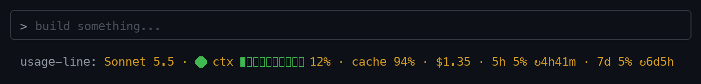

# usage-line

A [Claude Code](https://claude.com/claude-code) mod: one status line under the prompt.

```
Sonnet 5.5 · 🟢 ctx ▰▱▱▱▱▱▱▱▱▱ 12% 116k/1M · cache 94% · $1.35 · 5h 5% ↻4h41m · 7d 5% ↻6d5h
```



*Illustration of the line as context fills, not a screen recording.*

- **Context bar**: 🟢 under 30%, 🟡 30–70%, 🔴 over 70%
- **cache**: prompt-cache hit rate for this session (resets on a mod reload)
- **$**: session cost, as `/cost` totals it
- **5h / 7d**: rate-limit usage with time to reset

Needs Claude Code 2.1.287 or later (mods).

## Install

```
/plugin install usage-line --marketplace tusharranjan-ai/usage-line
```

Answer `y` to add the marketplace, then pick a scope.

## Notes

The status line is one fixed color, so colors come from emoji, not ANSI.

## License

MIT
